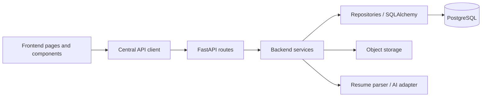

# CyberRakshak Project Structure

`PROJECT-STRUCTURE.md` is a hard contract. Future implementation must follow this structure unless the user approves a documented architecture change.

## Intended Repository Tree

```text
CyberRakshak/
├── PROJECT.md
├── AGENTS.md
├── SKILLS.md
├── PROJECT-STRUCTURE.md
├── DEMO-CREDENTIALS.md        (stays at root: the app's own UI points users to it)
├── README.md
├── .gitignore
├── .github/workflows/ci.yml
├── docker-compose.yml
├── design/
│   ├── Read.md.txt
│   ├── home/
│   ├── victim_Report/
│   ├── cyber_warrior/
│   └── explorations/          (home-page direction and typography experiments; not acceptance references)
├── docs/
│   ├── specs/
│   │   ├── 01-TECH-STACK.md
│   │   ├── 02-DATABASE.md
│   │   ├── 03-ARCHITECTURE.md
│   │   ├── 04-BACKEND.md
│   │   ├── 05-FRONTEND.md
│   │   ├── 06-API.md
│   │   ├── 07-DESIGN-SYSTEM.md
│   │   ├── 08-SECURITY.md
│   │   └── design.md
│   ├── architecture/          (RAG / LLM / full-stack architecture deep dives)
│   ├── history/               (phase + session reports, postmortems, evidence)
│   ├── screenshots/
│   ├── DEPLOYMENT.md, SUBMISSION.md, GIT-WORKFLOW.md
│   └── phase-9-operating-memory.md and other current operating notes
├── prompts/
│   ├── 01-foundation.md
│   ├── 02-database-data-layer.md
│   ├── 03-backend-api.md
│   ├── 04-frontend-design-system.md
│   ├── 05-victim-citizen-journey.md
│   ├── 06-cyber-warrior-journey.md
│   ├── 07-integration-testing.md
│   └── 08-production-readiness.md
├── frontend/
│   ├── app/
│   │   ├── [locale]/
│   │   │   ├── page.tsx
│   │   │   ├── login/
│   │   │   ├── report-crime/
│   │   │   ├── complaints/
│   │   │   ├── suspects/
│   │   │   ├── cyber-warrior/
│   │   │   └── admin/
│   │   ├── layout.tsx
│   │   └── globals.css
│   ├── components/
│   │   ├── ui/
│   │   ├── layout/
│   │   ├── complaint/
│   │   ├── cyber-warrior/
│   │   ├── evidence/
│   │   └── common/
│   ├── features/
│   │   ├── auth/
│   │   ├── complaints/
│   │   ├── suspects/
│   │   ├── cyber-warriors/
│   │   ├── notifications/
│   │   └── admin/
│   ├── lib/
│   │   ├── api/
│   │   ├── auth/
│   │   ├── i18n/
│   │   └── utils/
│   ├── hooks/
│   ├── messages/
│   │   ├── en.json
│   │   └── hi.json
│   ├── public/
│   ├── tests/              (node:test unit tests; `npm test`)
│   └── types/
├── backend/
│   ├── app/
│   │   ├── main.py
│   │   ├── core/
│   │   ├── models/
│   │   ├── schemas/
│   │   ├── api/v1/
│   │   ├── services/
│   │   │   ├── cyber_saathi/   (Cyber Saathi runtime: conversation, understanding, knowledge, LLM, voice)
│   │   │   ├── resume/         (resume extraction, structuring, LLM pass, parser)
│   │   │   └── *_service.py    (one module per remaining domain)
│   │   ├── repositories/
│   │   └── utils/
│   ├── evals/                  (offline Cyber Saathi quality measurement; `python -m evals.<name>`; not in the Docker image)
│   ├── alembic/
│   ├── tests/
│   └── requirements.txt
└── database/
    ├── seeds/
    └── README.md
```

## Folder Responsibilities

- Root documentation files: agent and reader entry points only (`README.md`, `PROJECT.md`, `AGENTS.md`, `SKILLS.md`, `PROJECT-STRUCTURE.md`, `DEMO-CREDENTIALS.md`).
- `design/`: visual source of truth. Do not edit design references during implementation.
- `docs/specs/`: the permanent architecture and operating contracts (tech stack, database, architecture, backend, frontend, API, design system, security, design rules). `AGENTS.md` and `SKILLS.md` link to them by full path, so agents still find them.
- `docs/architecture/`: deeper architecture write-ups (RAG pipeline, LLM, full-stack, scale path).
- `docs/history/`: phase and session reports, postmortems, and their evidence. Records of what happened, not current contracts.
- `docs/`: current operating notes (deployment, submission, git workflow, phase-9 operating memory).
- `prompts/`: phase-level implementation prompts.
- `frontend/`: Next.js application only. No backend business logic or database access.
- `backend/`: FastAPI API, business logic, validation, persistence integration, file handling, auth, and authorization.
- `database/`: seed data, local database notes, and database-specific support files. Alembic migrations live under `backend/alembic/`.

## Dependency Direction



Allowed dependencies flow inward from UI to API to services to data/storage. Backend code must never depend on frontend code.

## File Placement Rules

- Pages/routes: `frontend/app/[locale]/...`
- Shared UI primitives: `frontend/components/ui/`
- Layout/header/sidebar components: `frontend/components/layout/`
- Citizen complaint components: `frontend/components/complaint/` or `frontend/features/complaints/`
- Cyber Warrior components: `frontend/components/cyber-warrior/` or `frontend/features/cyber-warriors/`
- Evidence components: `frontend/components/evidence/`
- API clients: `frontend/lib/api/`
- Auth helpers: `frontend/lib/auth/`
- i18n configuration: `frontend/lib/i18n/` and `frontend/messages/`
- Backend routes: `backend/app/api/v1/`
- Pydantic schemas: `backend/app/schemas/`
- SQLAlchemy models: `backend/app/models/`
- Business logic: `backend/app/services/`. A domain that grows past a handful of modules gets its own package (as `cyber_saathi/` and `resume/` did) instead of a shared filename prefix.
- Database queries: `backend/app/repositories/`
- Migrations: `backend/alembic/`
- Offline evaluations (dataset normalisation, understanding / classification / retrieval / LLM quality reports): `backend/evals/`. The app must never import from `evals`. Reports are written to `backend/app/data/cyber_saathi/` unless `--output` is given.
- Backend tests: `backend/tests/`
- Frontend tests: `frontend/tests/` (shared helpers in `frontend/tests/support/`)

## Architecture Enforcement

Do not arbitrarily create new architectural layers or duplicate directories. If a structural change is required:

1. Stop before making the change.
2. Explain why the current structure is insufficient.
3. Check the relevant architecture document.
4. Update this document if the change is approved.
5. Then implement.
